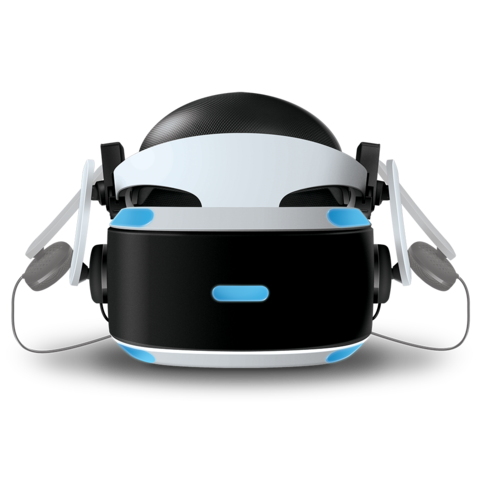

# VR-interface

The mixed-reality front end of the Society-5 project. The user sees the world from the robot's point of view in VR, and the actions they take there are repeated by the physical WowWee Robosapien X.



## Data flow

```
VR headset (user actions) → command-sender → UDP/JSON → robot-controller → infrared → Robosapien X
Robot's phone camera → video stream → VR view
```

Related repositories: [command-sender](https://github.com/Society-5/command-sender) and [robot-controller](https://github.com/Society-5/robot-controller).

Status: concept and design only. No source code has been committed yet.

---

Part of **[Society-5](https://github.com/Society-5)**: a WowWee Robosapien X that explores a floor on its own, using a phone camera and QR codes as markers, with a mixed-reality (VR) interface for remote control. See [Introduction](https://github.com/Society-5/Introduction) for the project overview.
